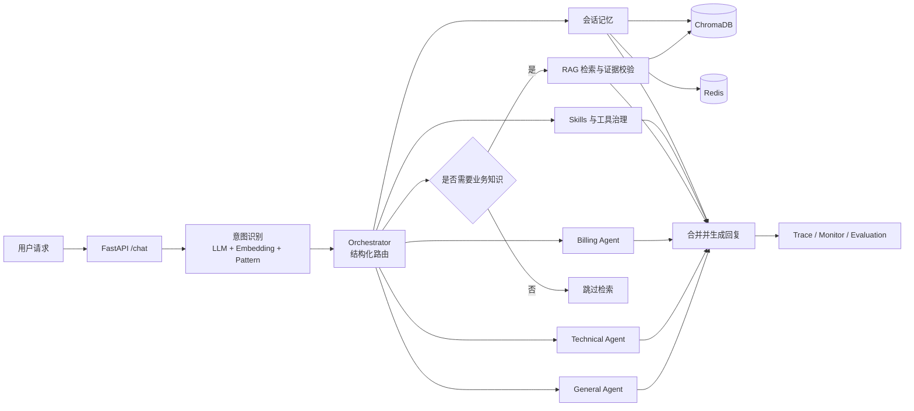

# EchoMind

> 面向企业软件客服场景的 Multi-Agent AI 产品原型：通过意图路由、RAG 证据门控、分层记忆和评测闭环，减少跨领域漏处理与无依据业务回答。

**作品集导航：** [AI 产品案例](docs/AI_PRODUCT_CASE_STUDY.md) · [静态产品演示](docs/PRODUCT_DEMO.md) · [工程案例](docs/PORTFOLIO_CASE_STUDY.md) · [当前评测报告](backend/evaluation/reports/e2e_current_top3_20261026.md) · [系统架构](docs/架构图.md)


## 30 秒了解项目

| 项目要素 | 内容 |
|---|---|
| 目标用户 | 企业软件客服团队及需要处理产品、技术、账单问题的一线客服 |
| 核心问题 | 单 Agent 容易漏掉复合诉求；模型可能编造退款时效、费用等业务事实；问题发生后难以定位具体链路 |
| 产品方案 | 用细粒度意图识别进行主/辅 Agent 路由；只对业务问题检索知识库；通过 Top-3 Evidence Selector 决定回答或拒答 |
| 我的工作 | 基于已有 EchoMind 项目完成环境复现、Qwen 接入、中文 Embedding 迁移、证据门控、路由与记忆修复、故障降级和分层评测 |
| 当前状态 | 本地可运行的作品集原型；尚未完成公网安全加固和生产流量验证 |

## 已验证的关键结果

| 结果 | 价值 | 口径 |
|---|---|---|
| 中文检索 Hit@1：55.56% → 97.22% | 改善中文口语问题的首位文档召回 | 同一 60 条冻结检索集上的 MiniLM/BGE 对比 |
| 知识缺口正确拒绝率：91.67% | 没有充分知识时优先拒答，降低编造政策的风险 | 24 条 Grounded Chat 冻结集 |
| 自动化回归：151/151 通过 | 为路由、工具、记忆和失败降级提供回归保护 | Mock 与本地依赖测试，不等于真实回答准确率 |

这些数据来自固定开发/冻结样本，不代表生产准确率或线上 SLA。完整指标与失败案例见[评测与边界](#评测与边界)。

## 产品处理流程

## 核心链路



## 典型用户场景

| 用户请求 | 产品行为 | 风险控制 |
|---|---|---|
| “退款审核需要多久？” | 路由至 Billing Agent，检索并选择退款政策证据 | 只有证据充分才回答具体时效 |
| “登录一直提示 401” | 路由至 Technical Agent，结合错误码工具给出排障步骤 | 区分平台事实与通用技术建议 |
| “电子发票多久开出来？” | 检索后判断知识库没有充分证据 | 明确拒绝确认时效，不让模型猜测 |
| “请转人工客服” | 进入 Escalation Agent 生成交接摘要 | 只使用结构化意图触发升级，不解析自由文本关键词 |

查看[静态产品演示](docs/PRODUCT_DEMO.md)，可了解界面字段和四类场景的观察重点。

## 关键产品决策

1. **按风险拆 Agent，而不是无限增加角色。** General、Technical、Billing、Escalation 分别承担接待、排障、账单和人工交接；复合请求可形成主 Agent 与辅助 Agent。
2. **把“召回相关文档”和“证据足够回答”分开。** 向量检索负责找到候选，Evidence Selector 决定是否允许生成平台业务事实。
3. **事实问题失败关闭，低风险建议允许降级。** Billing/General 无证据时拒答；Technical 仍可给出明确标注的通用排障建议。
4. **将失败当成产品信号。** Trace 记录意图、路由、证据、工具和阶段耗时，评测分别覆盖意图、检索、证据选择和完整链路。

## 评测与边界

不同评测集衡量不同层级，不能把各项百分比拼成一个“系统总准确率”。

| 评测 | 样本 | 当前结果 |
|---|---:|---|
| 意图冻结集 v2 | 95 条、19 类 | 准确率 98.95%，Macro-F1 98.94% |
| 检索冻结集 | 60 条 | BGE Hit@1 97.22%、Hit@3 100%；含负例的检索决策准确率 78.33% |
| Grounded Chat v2 | 24 条 | 严格证据选择 87.50%；知识缺口正确拒绝 91.67%；项目负责人确认的回答事实忠实度 83.33%（20/24） |
| 当前 Top-3 综合回归 | 7 场景、8 次真实请求 | 意图 75.00%；完整路由 75.00%；回答契约 75.00%；严格端到端 62.50%（5/8） |
| 自动化回归 | 151 项 | 151/151 通过 |

当前综合回归没有合并历史定向复测。3 个失败分别暴露问候标签不稳定、复合领域漏路由，以及记忆指令与严格证据门控的契约冲突。原始口径见[当前 Top-3 综合回归](backend/evaluation/reports/e2e_current_top3_20261026.md)。以上结果均为固定开发/冻结样本证据，**不代表生产准确率、稳定 SLA 或线上泛化能力**。

从产品角度，下一轮应优先处理复合意图召回和“保存信息”与“询问政策”的任务分流，而不是继续增加 Agent 数量。完整产品复盘见 [AI_PRODUCT_CASE_STUDY.md](docs/AI_PRODUCT_CASE_STUDY.md)。

## 技术实现

- Backend：Python、FastAPI、asyncio
- Model：Qwen API、Anthropic-compatible SDK
- Retrieval：ChromaDB、BGE Chinese Embedding
- Memory：Redis、ChromaDB
- Frontend：Vue、Vite
- Runtime：Docker Compose
- Observability：Prometheus-style metrics、structured trace

## 仓库结构

```text
backend/   Python + FastAPI 多 Agent 后端
frontend/  Vue + Vite 调试前端
docs/      工程改动、评测、架构与作品集案例资料
```

Java 版本未参与本轮工程验证，因此未纳入仓库。

## 快速启动

### 1. 准备环境

- Docker Desktop
- Node.js 20 或更高版本
- 可用的阿里云百炼 API Key，并已授权所选模型

### 2. 配置后端

```powershell
Set-Location backend
Copy-Item .env.example .env.local
```

只在本机编辑 `backend/.env.local`：

```env
ANTHROPIC_API_KEY=your_api_key
```

`.env` 已被 Git 忽略，不要提交真实密钥。

语义证据选择器默认启用，会为需要 RAG 的请求增加一次模型调用。它只接收最多 3 条候选的标题和正文；若超时、返回格式无效或判定无证据，系统按无证据处理，不把候选文档交给回复模型。可在本地 `.env` 调整：

```env
EVIDENCE_SELECTOR_ENABLED=true
EVIDENCE_SELECTOR_TOP_K=3
EVIDENCE_SELECTOR_MAX_TOKENS=512
EVIDENCE_SELECTOR_TIMEOUT_SECONDS=45
```

需要回滚到旧证据门控时，可设置 `EVIDENCE_SELECTOR_ENABLED=false`。

### 3. 启动后端

```powershell
Set-Location backend
docker compose up -d --build redis chromadb echomind
Invoke-RestMethod http://127.0.0.1:8000/health
```

### 4. 启动前端

```powershell
Set-Location frontend
npm ci
npm run dev -- --port 5174
```

访问 <http://127.0.0.1:5174/>，选择 Python 后端。

## 测试

```powershell
Set-Location backend
python -m venv venv
.\venv\Scripts\python.exe -m pip install -r requirements.txt
.\venv\Scripts\python.exe -m pytest -q
```

真实模型调用会消耗 API 额度，应与使用 mock 或本地依赖的自动化测试分开运行。

## 当前边界

- 外部模型调用延迟仍然偏高；当前综合回归 P95 为 68.00 秒，不能作为生产 SLA。
- LLM-as-Judge 框架已经实现，但尚未使用经过人工校准的大规模数据集验证。
- 未完成“约 500 条样本、91.3% 准确率”或“RAG 65% 提升至 83%”等实验，因此不使用这些数字。
- 当前 8 次综合回归仅 5 次严格通过，问候确定性识别、复合领域路由和记忆指令分流仍可继续优化。
- 项目内的 `MCPToolManager` 是内部工具管理抽象，不等同于完整标准 MCP Server/Client 协议。

## 来源与授权边界

本仓库基于原 EchoMind Python 后端和 Vue 前端进行工程改进，保留原项目来源，不宣称原始代码为本仓库维护者从零创作。根据仓库维护者确认，项目提供方已授权将该项目用于实习求职和公开作品展示；本仓库未对原始代码另行授予 MIT、Apache-2.0 等开源许可证。详见 [NOTICE.md](NOTICE.md)。
