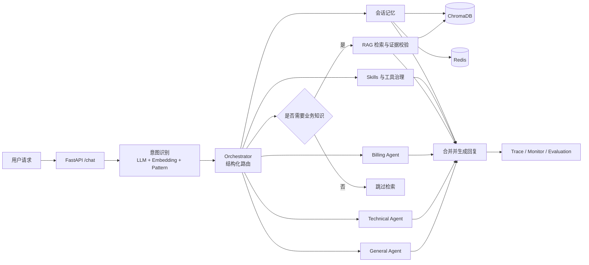

# EchoMind

面向企业客服场景的多 Agent 编排系统，覆盖细粒度意图识别、结构化路由、RAG 知识增强、分层记忆、动态 Skills、工具治理、运行监控和端到端评测。


## 项目定位

EchoMind 不把所有请求直接交给单个大模型，而是将一次客服请求拆成可观察、可验证的工程步骤：

1. 综合 LLM、中文 Embedding 和规则 Pattern 识别细粒度意图与实体；
2. 由 Orchestrator 选择主 Agent，并在复合问题中调度辅助 Agent；
3. 按意图决定是否检索知识库，避免问候等请求产生无效 RAG；
4. 使用知识证据、动态 Skills、工具结果和会话记忆约束回复；
5. 记录路由、工具调用、阶段耗时和模型调用，支持回归排错。

## 核心链路



## 本次工程工作

- 完成 Windows 本地环境、Docker 服务和阿里云百炼 Qwen API 的接入与联调。
- 接入 `BAAI/bge-small-zh-v1.5` 中文 Embedding，并使用独立 ChromaDB collection 保留回滚路径。
- 将本地向量检索设为默认模式，把查询改写和 LLM 重排调整为可选增强模式。
- 增加意图门控、Agent 领域过滤和语义证据选择器；仅把 Top-K 候选中被确认支持问题的一条证据交给回复模型，降低无效检索及无依据的政策/财务回答。
- 修正复合领域路由、工具调用后的回复生成、Redis 会话窗口与 ChromaDB 用户/会话过滤。
- 构建可审计端到端基准，记录意图、完整路由、回答契约、延迟和前台模型调用次数。

文件级改动见 [CHANGES.md](docs/CHANGES.md)，完整案例见 [PORTFOLIO_CASE_STUDY.md](docs/PORTFOLIO_CASE_STUDY.md)。

## 已核验结果

2026-10-18 的固定试运行包含 **7 个场景、8 次真实请求**：

| 指标 | 本轮结果 |
|---|---:|
| 人工标注意图匹配 | 8 / 8 |
| 主 Agent 匹配 | 8 / 8 |
| 完整路由匹配 | 8 / 8 |
| 回答契约通过 | 8 / 8 |
| 外部延迟 P50 | 41.04 s |
| 外部延迟 P95 | 92.50 s |
| 前台应用层模型调用 | 16 次，平均 2.00 次/请求 |

这些结果只说明固定场景链路在该轮试运行中通过，**不代表生产准确率、稳定 SLA 或大样本泛化能力**。原始口径见 [端到端试运行报告](backend/evaluation/reports/e2e_final_20261018.md)。

## 技术栈

- Backend：Python、FastAPI、asyncio
- Model：Qwen API、Anthropic-compatible SDK
- Retrieval：ChromaDB、BGE Chinese Embedding
- Memory：Redis、ChromaDB
- Frontend：Vue、Vite
- Runtime：Docker Compose
- Observability：Prometheus-style metrics、structured trace

## 仓库结构

```text
backend/   Python + FastAPI 多 Agent 后端
frontend/  Vue + Vite 调试前端
docs/      工程改动、评测、架构与作品集案例资料
```

Java 版本未参与本轮工程验证，因此未纳入仓库。

## 快速启动

### 1. 准备环境

- Docker Desktop
- Node.js 20 或更高版本
- 可用的阿里云百炼 API Key，并已授权所选模型

### 2. 配置后端

```powershell
Set-Location backend
Copy-Item .env.example .env
```

只在本机编辑 `backend/.env`：

```env
ANTHROPIC_API_KEY=your_api_key
```

`.env` 已被 Git 忽略，不要提交真实密钥。

语义证据选择器默认启用，会为需要 RAG 的请求增加一次模型调用。它只接收最多 3 条候选的标题和正文；若超时、返回格式无效或判定无证据，系统按无证据处理，不把候选文档交给回复模型。可在本地 `.env` 调整：

```env
EVIDENCE_SELECTOR_ENABLED=true
EVIDENCE_SELECTOR_TOP_K=3
EVIDENCE_SELECTOR_MAX_TOKENS=512
EVIDENCE_SELECTOR_TIMEOUT_SECONDS=45
```

需要回滚到旧证据门控时，可设置 `EVIDENCE_SELECTOR_ENABLED=false`。

### 3. 启动后端

```powershell
Set-Location backend
docker compose up -d --build redis chromadb echomind
Invoke-RestMethod http://127.0.0.1:8000/health
```

### 4. 启动前端

```powershell
Set-Location frontend
npm ci
npm run dev -- --port 5174
```

访问 <http://127.0.0.1:5174/>，选择 Python 后端。

## 测试

```powershell
Set-Location backend
python -m venv venv
.\venv\Scripts\python.exe -m pip install -r requirements.txt
.\venv\Scripts\python.exe -m pytest -q
```

真实模型调用会消耗 API 额度，应与使用 mock 或本地依赖的自动化测试分开运行。

## 当前边界

- 外部模型调用延迟仍然偏高，本轮 P95 超过 90 秒，不能作为生产 SLA。
- LLM-as-Judge 框架已经实现，但尚未使用经过人工校准的大规模数据集验证。
- 未完成“约 500 条样本、91.3% 准确率”或“RAG 65% 提升至 83%”等实验，因此不使用这些数字。
- 项目内的 `MCPToolManager` 是内部工具管理抽象，不等同于完整标准 MCP Server/Client 协议。

## 来源与授权边界

本仓库基于原 EchoMind Python 后端和 Vue 前端进行工程改进，保留原项目来源，不宣称原始代码为本仓库维护者从零创作。根据仓库维护者确认，项目提供方已授权将该项目用于实习求职和公开作品展示；本仓库未对原始代码另行授予 MIT、Apache-2.0 等开源许可证。详见 [NOTICE.md](NOTICE.md)。
