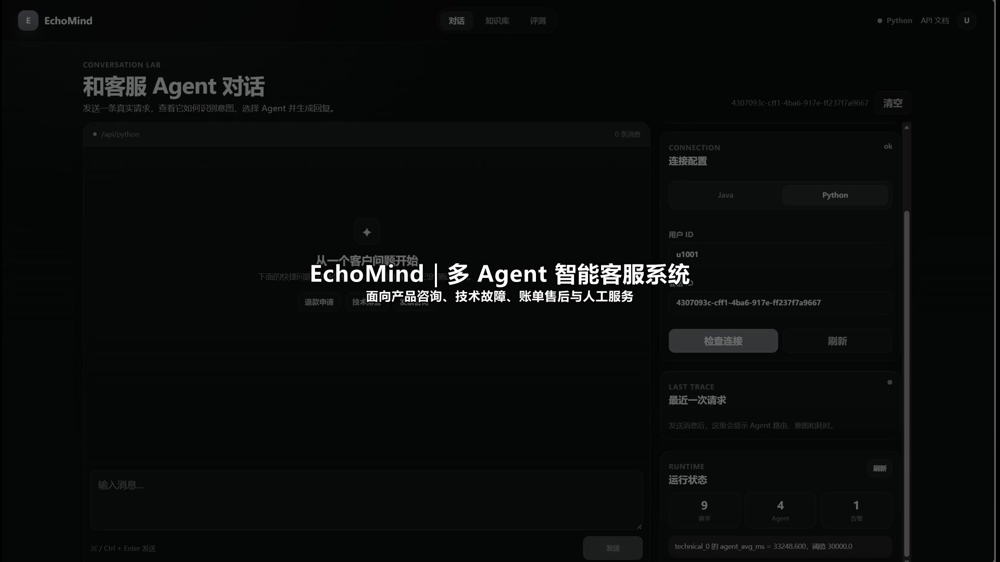

# EchoMind

**多 Agent 智能客服系统**

场景拆解 · Agent 工作流 · 知识库证据回答 · 质量评测 · Token 与响应优化

[▶ 88 秒演示视频](https://github.com/LMM1234556/EchoMind/blob/main/docs/assets/portfolio/echomind-demo.mp4) ·
[产品方案](docs/AI_PRODUCT_CASE_STUDY.md) ·
[需求与验收](docs/PRODUCT_REQUIREMENTS.md) ·
[评测与优化](docs/EVALUATION_COVERAGE.md) ·
[技术实现](docs/PORTFOLIO_CASE_STUDY.md)

视频展示退款咨询、401 排障、知识缺口处理、人工交接与运行轨迹。[播放或下载 MP4](https://raw.githubusercontent.com/LMM1234556/EchoMind/main/docs/assets/portfolio/echomind-demo.mp4) · [查看演示说明](docs/PRODUCT_DEMO.md)

## 项目概览

EchoMind 面向同时处理产品咨询、技术问题和账单售后的客服场景，将用户请求组织成“理解诉求 → 分配职责 → 查证知识 → 生成回复 → 评测改进”的工作流。

产品重点解决三类问题：一条消息中的多个诉求容易漏答；相关文档未必足以支持具体政策结论；多次模型调用会增加等待时间和 Token 消耗。系统通过多 Agent 分工、分项证据选择和组件级调用策略处理这些问题，并在调试工作台中展示决策依据。

| 角色 | 需求 | 对应能力 |
|---|---|---|
| 咨询用户 | 获得完整回答和清楚的下一步 | 逐项回应、政策说明、核实与人工交接 |
| 一线客服 | 区分产品、技术、账单等处理职责 | 意图识别、专业 Agent 路由、交接摘要 |
| 知识维护与运营人员 | 了解缺少哪些政策、哪些回答需要改进 | 文档管理、知识缺口状态、案例复盘 |
| 产品与研发人员 | 定位质量问题并权衡效果与成本 | Trace、分层评测、隔离配对对照 |

当前提供 Python 后端、Vue 调试工作台、演示知识库、评测数据和可复核报告。

## 主要工作与交付

在 EchoMind 原有架构上，维护者负责场景拆解、方案设计、开发任务拆分、代码审阅、样本复核和评测分析，并使用 Codex 辅助实现与迭代。

- **产品方案**：整理四类客服职责、核心用户流程、需求优先级与验收条件。
- **模型与检索**：接入 Qwen API，迁移中文 BGE Embedding，并建立同一冻结集上的检索对照。
- **回答质量**：接入 Top-3 Evidence Selector，对复合诉求分别检索和确认依据，逐项组织回复。
- **评测迭代**：完成意图、检索、回答覆盖、双人评分与 Judge 校准，将失败案例转化为改进项。
- **效率优化**：根据组件 Token 与耗时关闭结构化任务的思考模式，完成隔离配对对照。
- **交付体验**：提供演示视频、产品工作台、运行 Trace、Docker 启动方式和文档导航。

[实现与贡献范围](docs/IMPLEMENTATION_SCOPE.md) · [变更记录](docs/CHANGES.md) · [项目来源](NOTICE.md)

## 关键迭代与结果

| 问题 | 方案与决策 | 已验证结果 | 样本 |
|---|---|---|---|
| 中文口语查询召回不足 | 将知识库 Embedding 从 MiniLM 迁移至中文 BGE | Hit@1：55.56% → 97.22% | 同一 60 条冻结检索集，其中 36 条有答案查询 |
| 复合请求只回答一部分 | 拆分子问题、并行取证，按子问题保留证据状态 | 定向回归 4/4 完成目标，经人工复核 | 048、049、051、052 四条已知问题 |
| 结构化任务产生较多思考 Token | 对意图识别、证据选择和画像提取关闭思考，最终回复保留原配置 | 总 Token 下降 40.0%；平均响应 82.22 → 34.77 秒 | 4 题配对、两组各 4 次请求，均为全新会话 |
| 自动评分偏宽 | 双人评分、证据对齐复核与 Judge 校准 | 完成 24 条四维配对评分，采用人工复核进行质量验收 | 16 条校准、8 条同批留出验证 |
| 迭代后功能稳定性 | 持续维护工具、记忆、路由、证据门控和 MCP 协议回归 | 217/217 自动化检查通过 | 2026-11-08 验证 |

效果按对应样本和版本报告。性能对照固定先运行控制组、再运行实验组；延迟结果同时受到供应商运行状态影响。详见[性能报告](docs/PERFORMANCE_TOKEN_PROFILE_20261106.md)与[评测总览](docs/EVALUATION_COVERAGE.md)。

## 从问题到产品决策

**相关文档还需要进一步查证。** 用户询问电子发票时效时，退款或订单文档可能在主题上相关，但具体开票天数需要直接政策依据。系统单独判断“是否足以回答”，依据充分时生成事实，资料缺口进入核实路径。

**复合诉求按项处理。** 用户同时询问密码重置和发票时效时，系统可以回答有依据的密码问题，并说明发票时效需要核实。单个子问题的资料状态会保留在 Trace 中。

**按任务分配模型计算量。** 意图识别、证据选择、画像提取的目标是短 JSON；最终回复需要整合证据并解释。组件级思考策略在固定配对样本上验证质量与 Token 的变化。

**评测用于决定下一次改动。** 60 条覆盖评测形成首次请求基线：27 条通过、19 条部分完成、13 条未通过、1 条预算控制未完成。复合诉求漏答由此进入优先级较高的改进项，后续定向结果与该基线分别记录。

[完整产品案例](docs/AI_PRODUCT_CASE_STUDY.md) · [需求与验收说明](docs/PRODUCT_REQUIREMENTS.md)

## 工作流与技术实现

~~~mermaid
flowchart LR
    U[用户请求] --> I[意图与实体识别]
    I --> O[主辅 Agent 路由]
    O --> E[按需检索与分项证据选择]
    M[Redis 工作记忆 ChromaDB 历史与画像] --> O
    S[工具与动态 Skills] --> O
    K[中文 BGE / ChromaDB 知识库] --> E
    E --> A[Agent 生成与回复整合]
    O --> A
    A --> R[回答与核实路径]
    R --> T[Trace / 运行监控 / 评测]
~~~

| 能力 | 实现要点 |
|---|---|
| 意图识别 | LLM 语义判断、字符 n-gram 相似度、关键词 Pattern 加权融合；19 类意图及置信度、实体、紧急度 |
| Agent 编排 | General、Technical、Billing、Escalation；主辅路由、并行执行和结果整合 |
| Grounded RAG | 中文 BGE 召回、候选去重、Top-3 Evidence Selector、选中来源校验、复合诉求分项取证 |
| 工具治理 | 项目内 MCPToolManager；参数校验、TTL 缓存、超时、熔断与降级 |
| 标准 MCP | 官方 Python SDK；stdio / Streamable HTTP 客户端、工具白名单与角色权限；通过 `/mcp/` 提供知识检索和资源读取 |
| 动态 Skills | 从 Markdown/JSON 加载业务规范，按 Agent 职责注入，支持运行时重载 |
| 分层记忆 | Redis 工作记忆与摘要；ChromaDB 历史摘要和用户画像；用户与会话标识参与过滤 |
| 可观测性 | 记录意图、路由、工具、证据、阶段耗时和模型调用；支持 Metrics 与评测报告 |
| 开发与部署 | Python 3.12、FastAPI、Qwen API、Anthropic-compatible SDK、Vue 3、Vite 7、Docker Compose |

[工程案例](docs/PORTFOLIO_CASE_STUDY.md) · [架构图](docs/架构图.md) · [业务流程](docs/业务流程说明.md)

## 演示场景

| 输入 | 处理方式 | 可查看信息 |
|---|---|---|
| 退款审核需要多久，审核通过后多久能到账？ | Billing 检索并确认退款政策 | 时效、证据与调用轨迹 |
| 登录时一直提示 401，应该怎么排查？ | Technical 提供认证失败排查 | 平台依据与通用建议 |
| 密码忘了但手机号还在，电子发票最晚几天开好？ | 两项诉求分别取证和回答 | 已确认依据与资料缺口 |
| 我已经处理多次还没解决，请转人工客服 | Escalation 整理交接信息 | 升级状态与摘要 |

## 评测资料

| 评测 | 数据与方法 | 报告 |
|---|---|---|
| 意图识别 | 95 条、19 类人工审核的冻结合成样本；Accuracy 98.95%，Macro-F1 98.94% | [首次结果](backend/evaluation/reports/intent_test_v2_first_run_20261026.md) |
| 中文检索 | 60 条冻结查询；Hit@1 统计 36 条有答案查询，另含 24 条负例 | [MiniLM/BGE 对照](backend/evaluation/reports/retrieval_test_v1_first_run_20261026.md) |
| 证据与回答 | 24 条 Grounded Chat v2；严格选证 21/24，事实忠实度复核 20/24 | [证据与回答报告](backend/evaluation/reports/grounded_chat_test_v2_first_run_20261026.md) |
| 完整回答覆盖 | 60 条目标回答；事实、覆盖、操作真实性和安全四项验收 | [分组结果](backend/evaluation/reports/answer_coverage_60_v1_summary_20261106.md) |
| Judge 校准 | 同一批 24 条回答、双人四维评分、16/8 切分 | [校准分析](backend/evaluation/reports/judge_calibration_v1_findings_20261104.md) |
| 定向性能对照 | 4 题配对，两组各 19 次模型调用，目标质量均经人工确认 | [正式 A/B 记录](backend/evaluation/reports/performance_ab_4cases_20261106.md) |

上述评测覆盖不同层级，阅读时以对应报告中的样本、版本和验收标准为准。真实参与者可用性测试采用单独的[产品验证方案](docs/PRODUCT_VALIDATION_PLAN.md)。

## 本地运行

环境：Docker Desktop、Node.js 22.12+、已授权所选模型的百炼 API Key。

~~~powershell
git clone https://github.com/LMM1234556/EchoMind.git
Set-Location EchoMind\backend
Copy-Item .env.example .env
~~~

在 backend/.env 中填写 ANTHROPIC_API_KEY，并确认 ANTHROPIC_MODEL 和 ANTHROPIC_BASE_URL 对应账号地域。该文件由 Git 忽略。

~~~powershell
docker compose config --quiet
docker compose up -d --build redis chromadb echomind
Invoke-RestMethod http://127.0.0.1:8000/health

Set-Location ..\frontend
npm ci
npm run dev -- --port 5174
~~~

访问 <http://127.0.0.1:5174/>，选择 Python 后端。[完整使用指南](docs/完整使用指南.md)提供本地 Python 环境、模型缓存、接口和排障说明。

自动化回归在 backend 目录执行：

~~~powershell
python -m pytest tests -q
~~~

模型参数、Evidence Selector 与结构化任务思考策略见 backend/.env.example 和[性能报告](docs/PERFORMANCE_TOKEN_PROFILE_20261106.md)。

## 文档导航

| 阅读目标 | 入口 |
|---|---|
| 理解用户、需求与产品决策 | [产品案例](docs/AI_PRODUCT_CASE_STUDY.md) · [需求与验收](docs/PRODUCT_REQUIREMENTS.md) |
| 查看产品操作与演示 | [演示视频](docs/assets/portfolio/echomind-demo.mp4) · [场景说明](docs/PRODUCT_DEMO.md) |
| 核对效果与优化证据 | [评测总览](docs/EVALUATION_COVERAGE.md) · [性能 A/B](backend/evaluation/reports/performance_ab_4cases_20261106.md) |
| 理解代码与架构 | [工程案例](docs/PORTFOLIO_CASE_STUDY.md) · [实现范围](docs/IMPLEMENTATION_SCOPE.md) · [架构](docs/架构图.md) |
| 配置与运行 | [使用指南](docs/完整使用指南.md) · [安全配置](SECURITY.md) |
| 查看全部文档 | [文档中心](docs/README.md) |

## 后续迭代

- **用户体验**：按五个固定任务开展小规模参与者测试，记录任务完成率、用时和可信度。
- **回答质量**：完善事实查询、信息补充和操作请求的分流，增强交接摘要。
- **响应效率**：在更多请求类型上验证思考策略、调用合并和上下文压缩。
- **应用集成**：基于标准 MCP 接入更多知识服务，按业务需要扩展订单与工单接口。

## 项目来源

本仓库在 EchoMind Python 后端和 Vue 前端基础上开展产品与工程改进。来源、署名和展示授权说明见 [NOTICE.md](NOTICE.md)。
