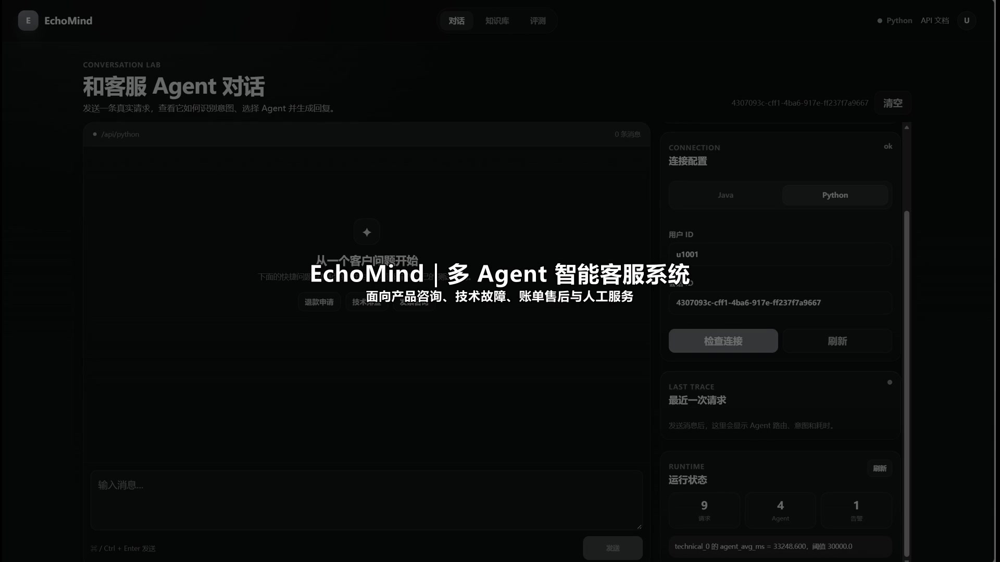
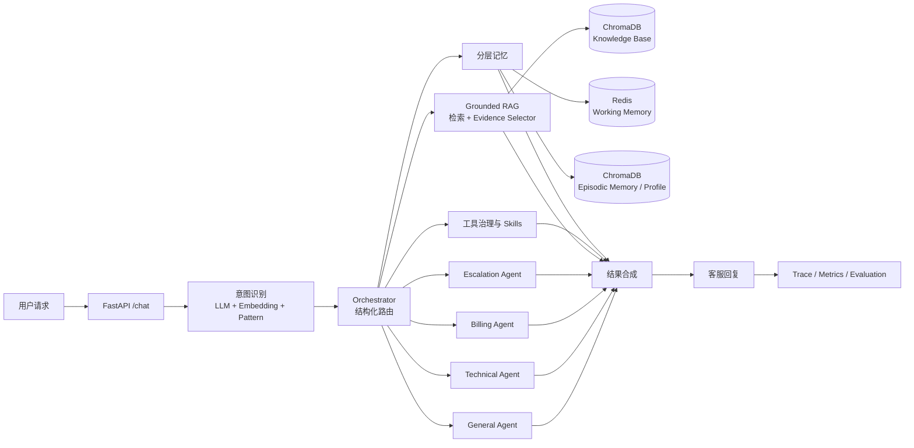

<div align="center">

# EchoMind

**面向企业软件客服的 Multi-Agent AI 系统｜Agent 工程 × AI 产品实践**

业务场景定义 · 意图识别 · 主辅 Agent 协作 · Grounded RAG · 分层记忆 · 工具治理 · 全链路评测


[▶ 查看 88 秒演示视频](https://github.com/LMM1234556/EchoMind/blob/main/docs/assets/portfolio/echomind-demo.mp4) ·
[⬇ 直接播放 / 下载 MP4](https://raw.githubusercontent.com/LMM1234556/EchoMind/main/docs/assets/portfolio/echomind-demo.mp4) ·
[AI 产品案例](docs/AI_PRODUCT_CASE_STUDY.md) ·
[评测报告](backend/evaluation/reports/e2e_current_top3_20261026.md) ·
[系统文档](docs/README.md)

</div>

[](https://github.com/LMM1234556/EchoMind/blob/main/docs/assets/portfolio/echomind-demo.mp4)

> 点击封面查看约 88 秒的产品与 Agent 系统演示：从退款咨询、401 技术故障和知识缺口识别，到人工交接、产品架构与分层评测；也可使用上方入口直接播放或下载 MP4。

## 目录

- [项目概览](#项目概览)
- [个人工作](#个人工作)
- [核心成果](#核心成果)
- [系统架构](#系统架构)
- [核心能力](#核心能力)
- [Agent 职责与产品场景](#agent-职责与产品场景)
- [可靠性与可观测性](#可靠性与可观测性)
- [分层评测](#分层评测)
- [技术栈](#技术栈)
- [快速启动](#快速启动)
- [仓库结构](#仓库结构)
- [文档导航](#文档导航)
- [后续迭代](#后续迭代)

## 项目概览

EchoMind 面向同时处理产品咨询、技术故障、账单售后和人工服务的一线客服团队。系统将一条用户消息转化为结构化意图和路由决策，由专业 Agent 协作处理，并通过知识库证据、会话记忆与运行 Trace 支撑可追踪的回答链路。

本项目同时从两个视角呈现个人能力：

- **Agent 应用与工程视角**：展示意图融合、主辅路由、工具治理、RAG 证据门控、记忆隔离、可观测性和自动化回归；
- **AI 产品视角**：展示用户问题拆解、Agent 职责设计、需求优先级、核心链路、指标体系、评测发现与迭代规划。

| 项目要素 | 内容 |
|---|---|
| 目标用户 | 企业软件客服团队，以及需要统一处理产品、技术和账单问题的一线客服 |
| 产品目标 | 提升复合诉求覆盖率、平台业务事实的证据完整性，以及问题定位和评测效率 |
| 核心方案 | 细粒度意图识别 + 主辅 Agent 路由 + Grounded RAG + 分层记忆 + Trace/Evaluation |
| 当前形态 | 本地可运行的产品原型、公开代码仓库、产品演示视频和可复核评测报告 |
| 核心链路 | `用户请求 → 意图识别 → Agent 路由 → 工具/知识/记忆 → 回复合成 → Trace 与评测` |

## 个人工作

本仓库在已有 EchoMind 项目基础上完成产品化改进与工程验证，个人工作集中在以下方面：

- 梳理产品咨询、技术故障、账单售后和人工交接四类业务职责，完善主 Agent 与辅助 Agent 的协作路径；
- 接入 Qwen API，并将中文检索模型从 MiniLM 迁移至 BGE，建立同一冻结集上的前后对照；
- 将 RAG 接入真实 `/chat` 链路，引入 Top-3 Evidence Selector 和知识缺口识别；
- 修复复合意图路由、工具调用、会话隔离和记忆指令分流，完善组件异常时的连续服务策略；
- 建设意图、检索、证据选择、完整链路与自动化回归的分层评测体系；
- 设计产品调试工作台、运行 Trace、评测报告和作品集演示材料。

## 核心成果

| 能力层 | 已验证结果 | 样本与口径 |
|---|---:|---|
| 意图识别 | Accuracy **98.95%**，Macro-F1 **98.94%** | 95 条、19 类冻结合成样本 |
| 中文检索 | Hit@1 **55.56% → 97.22%**，BGE Hit@3 **100%** | 同一 60 条冻结检索集上的 MiniLM/BGE 对照 |
| 证据选择 | 严格证据选择 **87.50%** | 24 条 Grounded Chat v2 冻结集 |
| 知识缺口识别 | **91.67%** | 同一 24 条 Grounded Chat v2 冻结集 |
| 回答事实忠实度 | **83.33%（20/24）** | 项目负责人逐条复核 |
| 完整链路 | 严格端到端 **62.50%（5/8）** | 7 个场景、8 次单轮真实请求基线 |
| 工程回归 | **151/151** 通过 | Mock 与本地依赖自动化测试 |

各项指标分别衡量意图、检索、证据门控、回答质量和完整链路，并按对应样本范围独立解读。原始证据见[当前 Top-3 综合回归](backend/evaluation/reports/e2e_current_top3_20261026.md)与[评测资料](backend/evaluation/reports/)。

## 系统架构



### 请求处理流程

1. **接收请求**：`/chat` 校验用户、会话和消息，加载当前会话上下文；
2. **识别意图**：融合 LLM 语义判断、Embedding 相似度和关键词 Pattern，输出结构化意图与置信度；
3. **生成路由**：Orchestrator 选择主 Agent，并为复合诉求补充辅助 Agent；
4. **获取上下文**：按需要并行调用工具、Skills、知识库和会话记忆；
5. **确认业务证据**：从候选文档中选择能够支持当前问题的证据；
6. **合成回复**：保留主辅 Agent 的职责信息，生成面向用户的统一回答；
7. **记录与评测**：保存意图、路由、工具、证据和阶段耗时，供调试与回归使用。

## 核心能力

| 能力 | 技术实现 | 产品价值 |
|---|---|---|
| 多 Agent 编排 | General、Technical、Billing、Escalation 四类 Agent；结构化主辅路由；异步并行执行 | 让不同业务职责独立演进，并覆盖技术与账单等复合诉求 |
| 细粒度意图识别 | LLM + Embedding + Pattern 加权融合；19 类业务意图；结构化置信度与来源分数 | 为 Agent 路由、知识检索和人工交接提供统一决策入口 |
| Grounded RAG | 快速关键词/向量检索、查询改写、Top-K 召回、LLM 重排、Evidence Selector | 将“找到相关文档”和“文档足以回答”分成两个可评测阶段 |
| 工具与 Skills | 参数校验、超时、TTL 缓存、熔断、Fallback；Markdown/JSON 规则热加载 | 让业务规则与代码解耦，并提升外部组件波动下的服务连续性 |
| 分层记忆 | Redis 工作记忆与摘要；ChromaDB 情景记忆和用户画像；用户/会话隔离 | 支持多轮对话、历史信息召回和可控的上下文压缩 |
| 可观测与评测 | Tool Trace、阶段耗时、Prometheus-compatible Metrics、冻结集和 LLM-as-Judge 框架 | 将问题定位到意图、路由、检索、证据选择或生成阶段 |

> `MCPToolManager` 是项目内部的工具治理抽象，负责统一调用、缓存、熔断、降级和重排；后续可继续扩展标准 MCP Server/Client 协议。

## Agent 职责与产品场景

### Agent 职责矩阵

| Agent | 主要职责 | 典型工具/上下文 | 输出重点 |
|---|---|---|---|
| General | 接待、范围澄清、一般咨询 | 通用 Skills、知识检索 | 理解需求并给出下一步 |
| Technical | 登录、错误码、配置和技术排障 | 错误码查询、技术知识库 | 区分平台事实与通用排障建议 |
| Billing | 支付、退款、发票和账单问题 | 账单 Skills、政策证据 | 基于已确认依据说明规则与时效 |
| Escalation | 人工服务和高优先级交接 | 结构化意图、会话摘要 | 生成可继续处理的交接信息 |

### 典型产品场景

| 用户请求 | 系统行为 | 可观察结果 |
|---|---|---|
| “退款审核需要多久？” | 识别 `refund`，路由 Billing，检索并选择退款政策证据 | 展示 Agent、意图、证据和工具耗时 |
| “登录一直提示 401” | 路由 Technical，结合错误码工具和技术知识生成排障建议 | 展示技术 Agent 与工具 Trace |
| “电子发票多久开出来？” | 检索后识别当前知识库的时效证据缺口 | 说明依据范围并引导进一步核验 |
| “请转人工客服” | 进入 Escalation，生成结构化人工交接摘要 | 展示升级意图和交接结果 |

更多界面字段和操作步骤见[静态产品演示](docs/PRODUCT_DEMO.md)。

## 可靠性与可观测性

### 工具治理

- **参数校验**：工具调用前验证必填参数和类型；
- **TTL 缓存**：相同参数复用结果，降低重复检索与模型调用；
- **超时与熔断**：限制单次调用时长，并依据近期成功率维护熔断状态；
- **Fallback**：知识库或工具异常时返回结构化降级结果；
- **并行协作**：主辅 Agent 并行执行，单个辅助结果异常时保留成功结果；
- **结果 Trace**：记录调用来源、输入、成功状态、耗时、检索模式和证据选择结果。

### 记忆与数据隔离

- Redis 保存当前工作记忆和会话摘要，默认 TTL 为 24 小时；
- ChromaDB 保存情景记忆和用户画像；
- 数据键与向量元数据同时包含 `user_id` 和 `conversation_id`；
- 摘要压缩保留关键历史信息，控制上下文长度；
- Redis 或 ChromaDB 状态变化时，主对话链路继续提供清晰响应。

### 可观测接口

| 接口 | 作用 |
|---|---|
| `GET /health` | 查看服务健康状态 |
| `GET /metrics` | 输出 Prometheus-compatible 指标文本 |
| `GET /monitor/summary` | 查看 Agent、工具与延迟摘要 |
| `GET /trace/tool/{request_id}` | 查询单次请求工具 Trace |
| `GET /trace/tools` | 查看近期工具调用记录 |
| `POST /skills/reload` | 热加载 Skills 规则 |

## 分层评测

EchoMind 将“模型是否理解”“能否找到文档”“证据是否足够”“完整回答是否符合契约”分开评测，使每个结果都能映射到具体产品能力。

| 评测层 | 关注问题 | 当前证据 |
|---|---|---|
| 意图 | 是否识别正确业务场景和细粒度意图 | 95 条、19 类冻结集 |
| 检索 | 正确文档是否进入 Top-1/Top-3 | 60 条 MiniLM/BGE 对照集 |
| 证据门控 | 是否选对证据并识别知识缺口 | 24 条 Grounded Chat v2 |
| 回答质量 | 回复是否忠于已选证据 | 24 条逐条事实复核 |
| 完整链路 | 意图、路由、证据和回答是否同时满足契约 | 7 场景、8 次真实请求 |
| 工程回归 | 关键机制在版本迭代后是否持续稳定 | 151 项自动化测试 |

当前完整链路基线定位了三个明确的迭代方向：问候标签稳定性、复合领域路由，以及“保存信息”与“询问政策”的任务分流。完整分析见[AI 产品案例](docs/AI_PRODUCT_CASE_STUDY.md)和[当前评测报告](backend/evaluation/reports/e2e_current_top3_20261026.md)。

## 技术栈

| 层级 | 技术 |
|---|---|
| Backend | Python 3.11、FastAPI、Pydantic、asyncio |
| Model | Qwen API、Anthropic-compatible SDK |
| Retrieval | BGE Chinese Embedding、ChromaDB、关键词/向量检索、LLM Rerank |
| Memory | Redis、ChromaDB |
| Frontend | Vue 3、Vite 7 |
| Runtime | Docker、Docker Compose |
| Observability | prometheus-client、structured trace、performance monitor |
| Evaluation | pytest、冻结评测集、人工事实复核、LLM-as-Judge 框架 |

## 快速启动

### 环境要求

- Docker Desktop
- Node.js 20+
- 阿里云百炼 API Key，并已授权所选 Qwen 模型

### 1. 配置后端

```powershell
Set-Location backend
Copy-Item .env.example .env.local
```

在本地 `backend/.env.local` 中填写模型密钥。当前兼容层沿用以下变量名：

```env
ANTHROPIC_API_KEY=your_api_key
```

真实密钥保存在本地 `.env.local`；该文件已由 Git 忽略。

### 2. 启动 Redis、ChromaDB 与后端

```powershell
Set-Location backend
docker compose up -d --build redis chromadb echomind
Invoke-RestMethod http://127.0.0.1:8000/health
```

### 3. 启动前端

```powershell
Set-Location frontend
npm ci
npm run dev -- --port 5174
```

访问 <http://127.0.0.1:5174/>，选择 Python 后端。

### 4. 运行自动化测试

```powershell
Set-Location backend
python -m venv venv
.\venv\Scripts\python.exe -m pip install -r requirements.txt
.\venv\Scripts\python.exe -m pytest -q
```

真实模型评测与 Mock/本地依赖测试分别运行，便于独立统计模型效果、API 用量和响应耗时。

<details>
<summary><strong>Evidence Selector 配置</strong></summary>

```env
EVIDENCE_SELECTOR_ENABLED=true
EVIDENCE_SELECTOR_TOP_K=3
EVIDENCE_SELECTOR_MAX_TOKENS=512
EVIDENCE_SELECTOR_TIMEOUT_SECONDS=45
```

Evidence Selector 接收最多 3 条候选文档的标题与正文，将完成证据确认的文档传递给回复模型。

</details>

## 仓库结构

```text
EchoMind/
├── backend/
│   ├── agents/        # General / Technical / Billing / Escalation Agent
│   ├── api/           # FastAPI 路由、健康检查、Trace 与 Metrics
│   ├── core/          # 意图、数据模型与 Orchestrator
│   ├── mcp/           # 项目内部工具治理与 ChromaDB 知识库
│   ├── memory/        # Redis + ChromaDB 分层记忆
│   ├── monitor/       # 性能监控、告警与路由惩罚
│   ├── skills/        # Markdown / JSON 动态业务规则
│   ├── evaluation/    # 冻结数据、评测脚本与报告
│   └── tests/         # 自动化回归测试
├── frontend/          # Vue + Vite 产品调试工作台
├── docs/              # 产品案例、架构、运行指南和评测协议
├── NOTICE.md          # 项目来源与展示说明
└── SECURITY.md        # 密钥与部署安全说明
```

## 文档导航

| 文档 | 适合阅读的人 | 内容 |
|---|---|---|
| [AI 产品案例](docs/AI_PRODUCT_CASE_STUDY.md) | HR、AI 产品面试官 | 用户、问题、方案、优先级、指标和迭代 |
| [静态产品演示](docs/PRODUCT_DEMO.md) | 首次查看项目的人 | 四类核心场景和界面观察重点 |
| [工程案例](docs/PORTFOLIO_CASE_STUDY.md) | 技术面试官 | 工程问题、改进方案、验证方式和结果 |
| [系统架构](docs/架构图.md) | 架构/后端面试官 | 服务、Agent、工具、记忆、存储与部署结构 |
| [完整使用指南](docs/完整使用指南.md) | 本地运行者 | 配置、启动、接口、数据和排障说明 |
| [Embedding 对照](docs/EMBEDDING_BENCHMARK.md) | RAG/算法面试官 | MiniLM 与 BGE 的受控对比 |
| [RAG 评测协议](docs/RAG评测协议.md) | 评测面试官 | 数据口径、指标定义和可复核流程 |
| [变更记录](docs/CHANGES.md) | 代码审阅者 | 主要工程改进与验证摘要 |

## 后续迭代

1. **复合意图召回**：增强技术与账单等跨领域诉求的多标签识别；
2. **任务分流**：进一步区分记忆写入、事实查询和操作请求；
3. **响应性能**：减少重复查询改写和重排调用，记录阶段 Token 与成本；
4. **评测校准**：使用人工评分样本校准 LLM-as-Judge；
5. **产品验证**：开展小规模可用性测试，补充任务完成率、处理时间和可信度评分；
6. **公网试点**：增加认证、授权、限流、日志脱敏、知识库审核和集中式密钥管理。

## 项目来源与展示说明

本仓库基于原 EchoMind Python 后端和 Vue 前端开展产品化与工程改进，重点呈现 Qwen 接入、中文 Embedding 迁移、Grounded RAG、多 Agent 路由、分层记忆、可靠性治理和分层评测。项目提供方已授权将该项目用于实习求职和公开作品展示，具体说明见 [NOTICE.md](NOTICE.md)。
