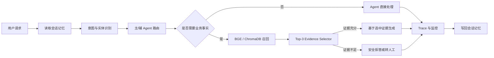

# EchoMind：AI 产品案例

## 1. 案例摘要

EchoMind 是一个面向企业软件客服场景的 Multi-Agent AI 产品原型。它关注的不是“模型能否生成一段客服话术”，而是如何把复杂客服请求拆解成可路由、可验证、可拒答和可复盘的产品链路。

本案例基于已有 EchoMind 项目进行产品化改进和工程验证。个人工作范围包括环境复现、Qwen API 接入、中文 Embedding 迁移、RAG 证据门控、多 Agent 路由修复、记忆隔离、故障降级和分层评测；不将原始系统描述为个人从零独立开发。

## 2. 用户与业务问题

### 目标用户

- 企业软件的一线客服：需要快速判断问题类型并给出下一步；
- 客服运营或知识库维护人员：需要知道回答使用了什么证据；
- AI 产品与研发团队：需要定位问题发生在识别、路由、检索还是生成阶段。

### 典型痛点

| 痛点 | 用户影响 | 产品风险 |
|---|---|---|
| 一条消息同时包含技术和账单诉求 | 只能解决其中一部分，用户需要重复描述 | 漏处理、重复转接 |
| 模型直接回答退款时效或费用 | 回复看似流畅，但可能没有平台依据 | 业务误导与信任损失 |
| 所有问题都检索知识库 | 闲聊也被无关文档干扰 | 延迟增加、误召回 |
| 只保存最终回复，不保存中间链路 | 无法解释为什么选了某个 Agent 或文档 | 难以迭代和回归 |
| 会话依赖外部存储 | Redis/ChromaDB 异常可能拖垮对话 | 可用性下降 |

## 3. 产品目标与非目标

### 本阶段目标

1. 将产品咨询、技术故障、账单售后和人工升级分配给职责明确的 Agent；
2. 对平台业务事实建立“检索—选择—生成”证据链；
3. 没有充分证据时安全拒答，而不是追求所有问题都有答案；
4. 记录可用于评测和定位的结构化 Trace；
5. 在外部模型或记忆组件失败时保留可理解的降级行为。

### 本阶段非目标

- 不接入真实订单、支付或工单系统；
- 不宣称已经达到生产流量准确率或稳定 SLA；
- 不把内部 `MCPToolManager` 描述为完整标准 MCP 协议；
- 不将尚未人工校准的 LLM-as-Judge 分数作为核心结果；
- 不直接公网部署未完成认证、限流和权限控制的本地原型。

## 4. 产品方案

### 4.1 请求链路

### 4.2 Agent 设计

| Agent | 主要职责 | 典型输入 | 关键边界 |
|---|---|---|---|
| General | 接待、澄清、一般咨询 | 问候、范围不明请求 | 不自行承诺高风险业务规则 |
| Technical | 登录、错误码和排障 | 401、页面异常、配置问题 | 通用建议不得伪装成平台事实 |
| Billing | 支付、退款、发票 | 重复扣款、退款时效 | 具体规则和时效必须有证据 |
| Escalation | 人工交接与摘要 | 明确转人工、CRITICAL 请求 | 使用结构化信号触发，不解析自由文本关键词 |

拆分原则不是“Agent 越多越好”，而是只有当业务域具有不同风险、工具和流程时才拆分。复合请求可由一个主 Agent 负责结果，另一个 Agent 提供辅助处理。

### 4.3 RAG 证据门控

产品将两个问题明确分开：

1. **哪篇文档最相关？** 由关键词与 BGE 向量检索回答；
2. **这篇文档是否足以回答当前问题？** 由 Evidence Selector 回答。

Evidence Selector 最多读取 Top-3 候选的标题和正文，不读取向量分数；它必须选择候选中的一篇，或明确返回证据不足。只有被接受的一篇文档会进入最终生成上下文。超时、非 JSON、未知标题或服务失败均按无证据处理。

### 4.4 记忆与降级

- Redis：保存当前会话的工作记忆和 TTL；
- ChromaDB：保存可语义检索的历史摘要和用户画像；
- 达到压缩阈值后保留摘要与最近消息，避免上下文无限增长；
- Redis 失败时退化为无工作记忆模式，ChromaDB 失败时使用空长期记忆，不阻断本次回答。

## 5. 产品需求优先级

| 优先级 | 需求 | 判断依据 | 当前状态 |
|---|---|---|---|
| P0 | 高风险业务事实无证据时不得确认 | 错误退款/费用规则的风险高 | 已实现失败关闭并评测 |
| P0 | 明确转人工必须稳定执行 | 用户已表达渠道偏好 | 已使用结构化升级节点 |
| P0 | 不同用户和会话不能串数据 | 隐私与回答正确性底线 | 已验证 Redis/ChromaDB 隔离 |
| P1 | 复合技术+账单请求主辅协作 | 减少漏处理 | 机制已实现，最终回归仍有漏路由 |
| P1 | 路由和证据可观察 | 支持排错和产品迭代 | 已在前端与 Trace 展示 |
| P2 | Skills 热加载 | 便于更新业务处理流程 | 已实现基础能力 |
| P2 | LLM-as-Judge 自动评分 | 降低人工评测成本 | 框架已实现，尚未完成人工校准 |

## 6. 指标体系

系统没有使用一个“总准确率”概括全部能力，而是按链路分层评测。

| 层级 | 关注问题 | 当前指标 |
|---|---|---|
| 意图 | 是否理解用户属于哪个业务场景 | 95 条、19 类冻结合成样本：Accuracy 98.95%，Macro-F1 98.94% |
| 检索 | 有答案时能否把正确文档排到前面 | 60 条冻结集：BGE Hit@1 97.22%、Hit@3 100% |
| 证据门控 | 无答案时能否拒绝，有答案时能否选对 | 24 条冻结集：严格证据选择 87.50%，知识缺口正确拒绝 91.67% |
| 最终回答 | 回复是否忠于可用事实 | 24 条冻结集：项目负责人逐条确认的事实忠实度 83.33% |
| 综合链路 | 意图、路由、证据和回答是否同时满足契约 | 8 次真实请求：严格通过 5/8 |
| 工程回归 | 修改是否破坏已有机制 | 151 项自动化测试全部通过 |

以上样本规模和来源不同，不能拼成一个系统总准确率。95 条意图集是经过项目负责人审核的合成冻结数据，不是生产流量；24 条回答复核不是独立第三方评审。

### 未来产品指标

如果进入真实业务试点，还应补充：人工转接率、一次解决率、无依据回答率、用户重述率、平均处理时长、单次 token 成本和人工纠错率。当前没有真实用户数据，因此不虚构这些业务指标。

## 7. 关键迭代

### 迭代一：中文召回

发现原英文 MiniLM 对中文口语问法召回不足。通过同一冻结检索集比较后，迁移到 `BAAI/bge-small-zh-v1.5`；Hit@1 从 55.56% 提升到 97.22%。由于新旧模型维度不同，新建独立 ChromaDB collection 并保留回滚路径。

### 迭代二：召回不等于证据

发现向量库即使没有答案也会返回“最近”文档。增加意图门控、领域过滤和 Top-3 Evidence Selector，并在退款、发票等政策问题上采用失败关闭。

### 迭代三：从成功截图转向冻结评测

将评测拆成意图、检索、证据门控和完整链路四层，保存原始 JSON 和 Markdown 报告。最终综合回归保留 3 个失败，没有通过改标签或合并定向复测包装成全绿。

### 迭代四：增强能力故障不阻断主链路

补充供应商超时、429、5xx、选择器非 JSON、工具熔断和 Redis 故障测试。Redis 不可用时继续提供无记忆回答，外部模型故障返回明确失败类型并保留已有工具轨迹。

## 8. 当前失败与下一步

| 已观察问题 | 产品解释 | 下一步 |
|---|---|---|
| 问候被识别为泛化 request | 简单高频意图不应完全依赖模型波动 | 增加高精度确定性前置规则 |
| “401 + 重复扣款”漏掉 Billing 路由 | 单标签意图可能覆盖复合诉求 | 增加复合领域多标签召回与路由测试 |
| “记住订单号”触发政策证据拒答 | 保存信息和查询规则属于不同任务 | 在意图层分离 memory action 与 policy question |
| 回答会补充证据外细节 | 选对证据不等于生成完全忠实 | 结构化事实输出与逐字段验证 |
| P95 响应约 68 秒 | 多次外部模型调用成为主要瓶颈 | 减少改写/重排调用，采集 token 与阶段成本 |

如果继续修改模型、Prompt 或阈值，应使用新的独立冻结集验证，不能回改已经查看结果的当前数据集。

## 9. 作品集结论

本项目当前能够证明的不是“AI 已经替代人工客服”，而是：能够将大模型客服拆成一条有业务边界、证据控制、失败降级和评测反馈的产品链路，并能根据真实失败决定下一轮优先级。

项目仍是本地作品集原型。公网部署前需要完成认证、授权、限流、严格 CORS、日志脱敏、密钥托管、知识库审核和数据保留策略。
