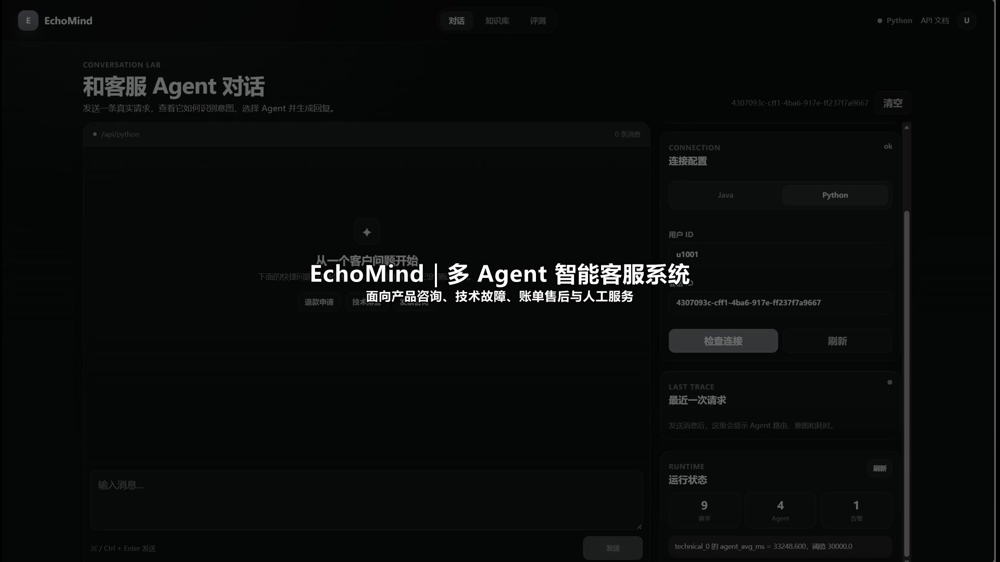
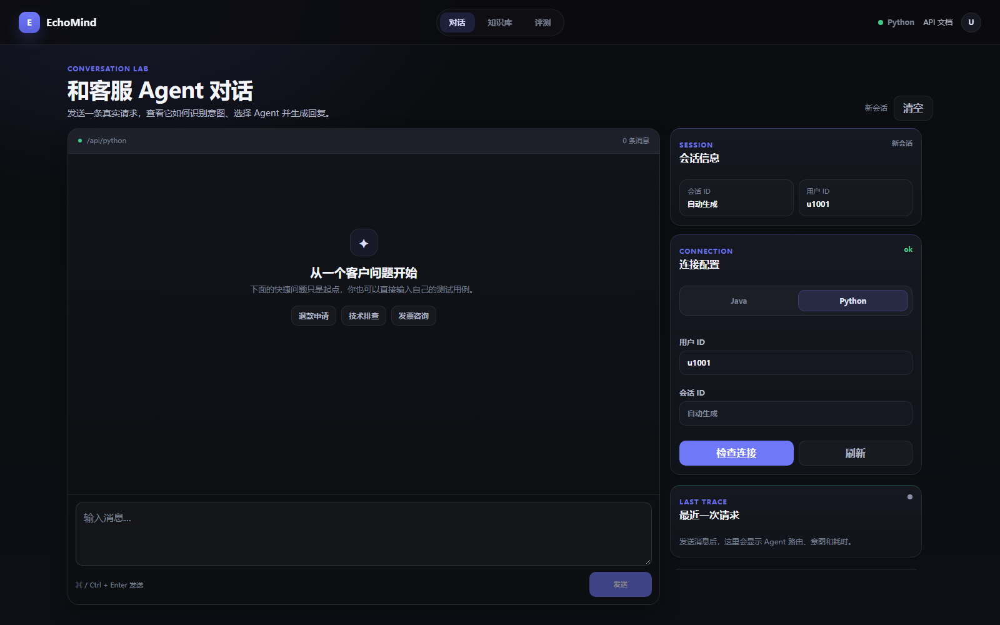

# EchoMind 演示与场景

[查看 88 秒视频](assets/portfolio/echomind-demo.mp4) · [播放或下载 MP4](https://raw.githubusercontent.com/LMM1234556/EchoMind/main/docs/assets/portfolio/echomind-demo.mp4)

视频展示退款咨询、401 排障、知识缺口、人工交接及运行轨迹。后续复合取证与 Token 优化的定量结果见[正式配对报告](../backend/evaluation/reports/performance_ab_4cases_20261106.md)。

## 工作台

| 区域 | 作用 |
|---|---|
| 对话区 | 输入问题并查看回答 |
| Session | 查看用户与会话标识 |
| Connection | 选择 Python 后端并检查连接 |
| Last Trace | 查看意图、Agent 职责、工具、证据和耗时 |
| Runtime | 查看请求量、Agent 状态与告警 |
| 知识库 | 添加业务文档并查看片段统计 |
| 评测 | 运行固定样例并查看评分与结果 |

## 场景与观察重点

### 1. 退款时效

> 退款审核需要多久，审核通过后多久能到账？

系统识别退款诉求，进入 Billing 并确认退款政策。观察回答是否分别保留审核与到账的起算条件，以及“工作日”单位。

### 2. 技术排障

> 登录时一直提示 401，应该怎么排查？

Technical 依据技术知识说明认证失败，提供账号密码检查和重置路径。观察平台事实与扩展通用建议是否清楚区分。

### 3. 复合诉求与知识缺口

> 密码忘了但手机号还在，另外电子发票最晚几天能开好？

两个子问题分别取证。密码重置依据账户安全文档回答，开票时限说明资料需要核实。观察两项诉求是否均得到回应，以及 Trace 中的分项证据状态。

### 4. 人工交接

> 我已经处理多次还没解决，请帮我转人工客服。

系统进入 Escalation，生成结构化交接摘要。观察升级标记、用户目标和已知信息。当前交付为交接摘要，工单系统连接列为后续接口集成。

## 本地体验

按[首页启动步骤](../README.md#本地运行)运行服务后，访问 http://127.0.0.1:5174/。新会话中输入上述问题，再查看 Last Trace 与知识库状态。

[产品方案](AI_PRODUCT_CASE_STUDY.md) · [需求与验收](PRODUCT_REQUIREMENTS.md) · [评测总览](EVALUATION_COVERAGE.md)
