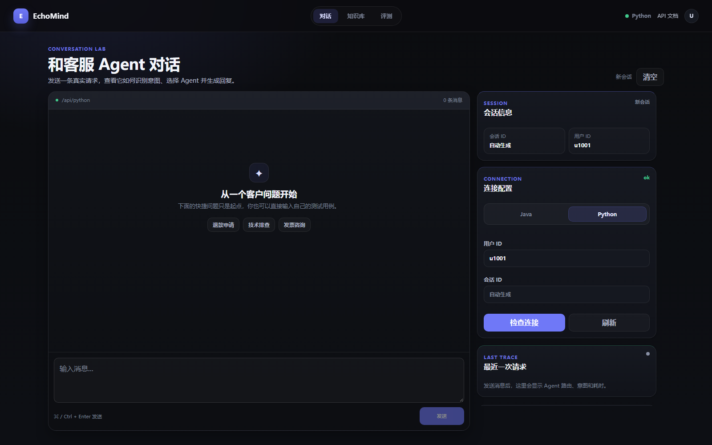

# EchoMind 静态产品演示

本页通过真实界面和典型场景，帮助招聘方快速了解产品。当前采用静态演示形式，兼顾访问效率、模型调用成本和本地原型的安全性。

## 界面应该看什么

- 左侧：用户与 Agent 的对话内容；
- 右侧 Session：用户与会话标识；
- Connection：当前 Python 后端连接状态；
- Last Trace：意图、主/辅 Agent、证据是否使用、工具调用和耗时；
- Runtime：Agent 请求量、运行状态和当前告警。

## 四个核心场景

### 场景一：有证据的退款时效

**输入**

> 退款审核需要多久，审核通过后多久能到账？

**预期产品行为**

1. 识别为退款类意图；
2. 路由至 Billing Agent；
3. 检索退款政策并运行 Evidence Selector；
4. 仅依据被接受的退款文档回答审核和到账时效；
5. Trace 标记知识库已使用、证据已接受。

### 场景二：技术故障排查

**输入**

> 登录时一直提示 401，应该怎么排查？

**预期产品行为**

1. 识别为 `technical_login`；
2. 路由至 Technical Agent；
3. 使用错误码和诊断工具；
4. 区分知识库事实与低风险通用排障建议。

### 场景三：知识缺口识别与核验引导

**输入**

> 电子发票通常多久能开出来？

**预期产品行为**

1. 识别为发票类意图并进入 Billing Agent；
2. 检索后识别当前知识库的时效证据缺口；
3. 明确说明当前依据范围；
4. 引导用户进一步核验或转人工。

### 场景四：明确要求人工

**输入**

> 我已经处理多次还没解决，请帮我转人工客服。

**预期产品行为**

1. 识别明确人工意图；
2. 路由至 Escalation Agent；
3. 生成交接摘要；
4. `escalated=true`，不依赖回答中是否出现“人工”关键词。

## 演示口径

- 上述场景基于当前实现和固定评测协议，外部模型生成的具体措辞会随请求略有变化；
- 当前最终综合回归已完成 8 次真实请求，并定位问候标签、复合领域路由和记忆指令分流三个优化方向；
- 原始结果与完整分析见[当前 Top-3 综合回归](../backend/evaluation/reports/e2e_current_top3_20261026.md)。
