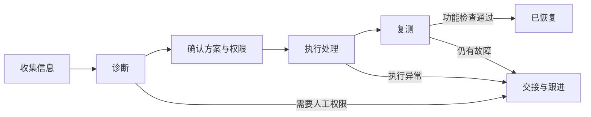

# 技术排障任务与结果验收设计

版本：0.1，2026-11-13。状态：后续业务集成设计；当前实现提供 401 排障指引、证据回答和人工交接摘要。

## 用户目标与首个场景

用户遇到接口认证失败，希望恢复正常访问。任务目标定义为：识别故障、提供适当处理方式，并通过复测结果确认恢复情况。首个集成范围选择可控的本地沙箱，使用测试身份和固定诊断数据。

| 阶段 | 用户体验 | 结果证据 |
|---|---|---|
| 收集信息 | 提供错误码、发生时间和请求标识 | 脱敏任务记录 |
| 诊断 | 查看允许读取的认证配置或诊断结果 | 工具返回的错误类别与来源 |
| 确认方案 | 了解建议操作、影响范围和执行人 | 用户确认与权限检查结果 |
| 处理 | 用户按指引处理，或由获授权工具执行沙箱操作 | 执行回执、状态与幂等标识 |
| 复测 | 对同一目标发起健康或认证探测 | 返回码及功能检查结果 |
| 结束或交接 | 展示恢复状态，或生成待跟进事项 | 成功复测结果，或可回查的工单编号 |

## 状态与成功条件

| 状态 | 判定依据 |
|---|---|
| 已给出指引 | 有针对性的排障步骤已交付 |
| 已恢复 | 同一任务对应的复测与功能检查均通过 |
| 已交接 | 工单接口确认受理并返回可回查编号 |
| 待补充 | 诊断所需信息仍待用户提供 |
| 未解决 | 复测失败，或异常后尚未形成有效跟进 |

认证接口恢复以探测和功能检查为依据。现有 `create_handoff_summary` 已提供交接材料；后续工单接口负责受理、编号和状态回查。

## 最小验收场景

| 场景 | 验收 |
|---|---|
| 诊断与处理成功 | 能关联诊断、确认、执行回执及复测结果 |
| 用户暂不执行 | 保留待处理状态，允许继续咨询 |
| 权限不足 | 提供需要的权限说明或交接路径 |
| 重复提交 | 使用同一幂等标识，操作结果可回查 |
| 操作超时 | 先查询执行状态，再决定后续动作 |
| 工具异常 | 记录失败阶段，交付明确下一步 |

## 指标

- 问题解决率：复测与功能检查通过的任务数 / 已开始的任务数；未完成与异常任务留在分母。
- 人工交接受理率：工单成功受理数 / 发起交接数，单独报告。
- 处理时长：从任务开始到恢复或交接的时间，按最终状态分组统计。
- 调用消耗：模型调用次数、供应商返回 Token、工具耗时；金额按实际计价单独计算。
- 风险检查：操作授权、状态误报、重复执行和敏感信息记录。

## 实施顺序

先完成沙箱任务状态与只读诊断，再接入一个获授权操作及结果回查，最后加入异常和幂等验证。接口契约、初始状态、预期状态与实际状态一起进入评测记录。真人体验观察按[产品验证方案](PRODUCT_VALIDATION_PLAN.md)单独组织。
